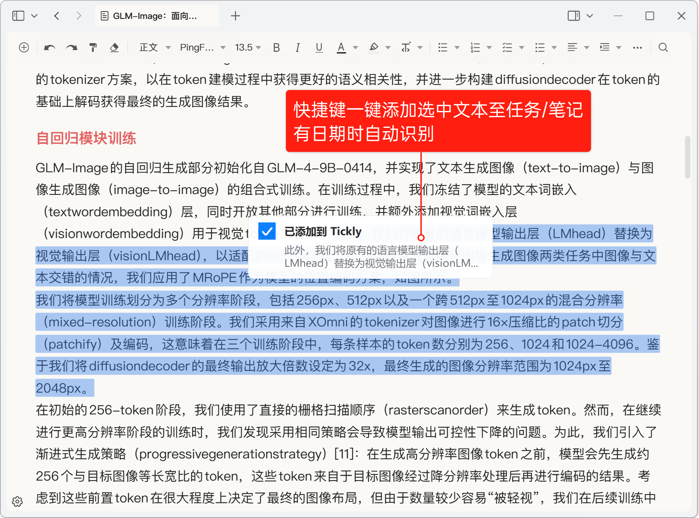

# Tickly

#### 一个极简，极快的GTD任务管理应用，也可一键添加任意界面选中的文本至应用保存，用作临时记事本





## 构建

需要 CMake ≥ 3.20 + Ninja，以及下面任一编译器（C++20）。产物都是 `build/Tickly.exe`：
单文件、静态链接运行库。

```bash
# 1) 默认：MSVC + Ninja（CI 用的就是这一条）
cmake -S . -B build -G Ninja -DCMAKE_BUILD_TYPE=Release
cmake --build build

# 2) 可选：clang-cl + lld-link（诊断更严，产物同样验证可运行）
cmake -S . -B build-clang -G Ninja -DCMAKE_BUILD_TYPE=Release \
      -DCMAKE_CXX_COMPILER=clang-cl -DCMAKE_LINKER=lld-link
cmake --build build-clang

# 3) 可选：mingw-w64（没有 MSVC 环境时）
cmake -S . -B build-mingw -G Ninja -DCMAKE_BUILD_TYPE=Release \
      -DCMAKE_CXX_COMPILER=g++ -DCMAKE_RC_COMPILER=windres
cmake --build build-mingw
```

工具链取舍：

| 工具链 | 定位 | 理由 |
| --- | --- | --- |
| **MSVC + Ninja** | 主力 | 与 CI 完全一致；`/MT` 静态 CRT 兼容性最好；调试/PDB 最稳 |
| clang-cl + lld-link | 可选 | 诊断更细（本次靠它找出 5 处 dead code）；但与 cl 混用 PDB/CRT 有坑，不作默认 |
| mingw-w64 | 可选 | 没有 MSVC 时可用，已验证；清单/代码页需要 `cmake/mingw64.specs` 与 `--codepage` |

Ninja 本身推荐：增量构建远快于 Make/MSBuild，三种工具链共用同一套命令。

资源必须参与链接：

| 资源 | 位置 | 缺失后果 |
| --- | --- | --- |
| 图标（数值 ID **1**）、版本信息 | `assets/resource.rc` | 白板图标 / 文件属性没有版本号 |
| DPI 感知清单 | MSVC：`assets/app.manifest`（link 的 `/MANIFESTINPUT`）<br>mingw：`assets/manifest.rc` | 非 100% 缩放下整窗位图拉伸，文字发虚 |

清单为什么分两条路：MSVC 下 CMake 会自动 `/MANIFEST:EMBED`，若 `.rc` 里再放一份
`RT_MANIFEST` 就报 `CVT1100 资源重复`；mingw 的 `ld` 又会报
`multiple non-default manifests`（默认清单来自 gcc 的 `default-manifest.o`，
由 `cmake/mingw64.specs` 去掉）。

## 目录结构

```
src/
  main.cpp            入口：DPI、单实例、注册窗口类、消息循环（组合根）
  common.h            公共包含与编译期开关

  core/               纯逻辑层（不引用任何 ui/ 代码）
    task.h              Task 数据模型
    text_util.*         宽窄字符串、空白整理、多行转义
    time_util.*         epoch/本地时间、周月边界、日期文案
    date_parse.*        「明天下午三点」这类自然语言解析

  ui/                 界面层
    context.*           跨模块共享的界面上下文：窗口/控件句柄、字体、DPI、布局矩形、悬停态
    theme.*             明暗调色板、字体设置、主题切换
    gdi_util.*          DPI 缩放、字体创建、画刷/画笔缓存
    dwm_shell.*         Win11 圆角 / 深色标题栏 / 边框色
    dark_mode.*         系统控件深色接入（uxtheme 逆序导出，菜单/编辑框/日期选择器）
    main_window.*       布局、标题区绘制、窗口过程
    list_view.*         自绘列表：行几何、平滑滚动、命中测试、交互、折行缓存
    list_paint.cpp      列表绘制（任务行 / 分组标题 / 汇总行）
    row_editor.*        行内编辑与自绘蓝色光标
    input_box.*         输入框子类化、占位文案、光标居中
    tray.*              托盘图标与菜单
    toast.*             划词结果气泡
    capture.*           划词添加任务
    autostart.*         开机自启（HKCU Run）
    hotkeys.*           全局快捷键
    reminder.*          到点提醒
    dialogs_*.         设置 / 日期 / 内存对话框模板

  app/                应用编排层（连接 core、ui 与持久化）
    ids.h               控件 / 菜单 / 自定义消息 ID
    version.h           版本号（唯一来源）
    rows.*              行模型：分组归属、展开状态、显示行重建
    actions.*           任务用例：新增/完成/删除/批量/清空/导出
    store.*             tasks.txt 读写（任务 + 全部设置项）

  platform/
    dpi.*               进程 DPI 感知（清单失效时的运行期兜底）

assets/               图标 app.ico、清单 app.manifest、资源脚本 resource.rc / manifest.rc
cmake/                mingw 链接 specs（去掉默认清单，避免与 app.manifest 冲突）
tools/                图标生成（make-icon.ps1）与杂项脚本
web/                  早期 HTML 原型，与程序运行无关
```

分层约定：

- `core/` 只做纯逻辑，`grep '#include "ui/' src/core` 应为空；
- 跨模块只通过头文件里的声明交互，模块私有状态/函数保持 `static`；
- `app/` 是编排层：负责把领域数据算成显示行（`rows`）、把用例落到数据（`actions`）、
  把状态写盘（`store`）。消息分发（`ui/main_window.cpp`）和入口（`main.cpp`）
  会向上调用 `app/`，属于 Win32 单窗口程序的正常交叉，不再强行拆一层控制器。

## 版本号

唯一来源是 `src/app/version.h` 的 `TICKLY_VERSION`。改版本时同步：

1. `src/app/version.h`
2. `assets/resource.rc` 的 `FILEVERSION` / `PRODUCTVERSION`
3. `assets/app.manifest` 的 `assemblyIdentity version`

CMake 在配置阶段校验三者一致，不一致直接失败；CI 也会重新校验图标 ID 与
内嵌清单（用 `LoadIcon(1)` 真实取一次图标）。

## 数据文件（v4）

数据文件是 exe 同目录的 `tasks.txt`（UTF-8，带 BOM），文本格式、一行一条记录：

```
V	4                                        格式版本（v4 起；旧文件没有本行）
E	1                                        兼容旧版：文本已转义
S	b	b	b	b	b	b	b	b	b	b	b              分组展开 + 已完成区收纳（11 个布尔）
C	b	min	b	mod	vk	mod	vk                 提醒 / 托盘 / 两个全局快捷键
W	max	left	top	right	bottom              窗口位置
F	字号	R	G	B ...                         字体与主题（追加式扩展）
T	done	doneAt	due	hasTime	notified	text   任务（text 末尾，可含转义换行）
```

- **版本行 `V`**：写入端恒定输出；读取端没有也不报错（旧文件按 v1~v3 规则解析）。
- **兼容性**：新版本只追加字段/未知行会被忽略，所以旧版本打开新文件也不会崩；
  实测旧版二进制能正常读出 v4 文件里的全部任务。
- **转义**：`\` → 反斜杠，`
` → 换行，`	` → 空格，`
` 丢弃。
- **原子写入**：先写 `tasks.txt.tmp` → 旧文件备份为 `tasks.txt.bak` →
  `MoveFileEx(REPLACE_EXISTING|WRITE_THROUGH)` 替换。断电/崩溃不会留下半截文件。
- **首次运行的数据来源**：exe 同目录没有数据时，依次尝试 当前目录 →
  `%APPDATA%Tickly	asks.txt` → `%APPDATA%TodoWin	asks.txt`，找到就复制过来
  （复制而非移动，源文件保留）。exe 同目录不可写时退回 `%APPDATA%Tickly`。

## 深色模式

- 应用层：自有绘制全部走 `COL_*` 主题色（`ui/theme.cpp` 的两套色板）。
- 系统层：`ui/dark_mode.cpp` 动态取 uxtheme 逆序导出 104/135/136，
  设置进程首选外观、刷新菜单主题，并给每个对话框套 DWM 深色标题栏 +
  给 Edit / ComboBox / HotKey（`DarkMode_CFD`）、DateTimePicker / ScrollBar
  （`DarkMode_Explorer`）换主题名。取不到这些导出（Win7/8）时静默降级。
- 快捷键采集框（`msctls_hotkey32`）不接受深色主题，改为只接管
  `WM_PAINT`/`WM_ERASEBKGND` 自绘，键盘采集仍由原控件处理。

## 性能

启动到「窗口可交互」（`MainWindowHandle` 非空且 `Responding`）。测量脚本会等上一个
实例**完全退出**再计时（否则单实例互斥体会让第二实例直接退出，被误判成快），
同一台机器、同一份数据、每个配置 **n=3**：

| 数据 | 重构前单文件版 | 当前 | 变化 |
| --- | --- | --- | --- |
| 5000 条任务 | 1785 ms（1671–1883） | **935 ms**（902–1002） | −48% |
| 空列表 | 229 ms（224–235） | 232 ms（232–233） | 持平 |

做法：

- 行高/宽度测量改用一个进程内内存 DC（原来每行 `GetDC`/`ReleaseDC` 各一次，
  5000 条任务就是 1 万次窗口 DC 往返）；
- 折行结果按「文本 + 可用宽度 + 字体高度」缓存，字号/DPI 变化自动失效；
- 深色模式只给主窗口套深色标题栏（子控件都是自绘或走 `WM_CTLCOLOR`），
  对话框仍全量套主题——否则空列表启动会多花约 100 ms。

复跑：`powershell -File build/_refactor/startup.ps1 -Exe <exe> -Runs 3`
（临时脚本，在 `.gitignore` 内的 `build/`）。

## 图标

`tools/make-icon.ps1` 生成 `assets/app.ico`（微信绿纯色基调）：

- 底：圆角方块，竖直渐变 `#0FCB6E`（顶）→ `#05BC5C`（底）。两端色相都在 ~149°，
  只变明度——不偏黄也不偏青；
- 字形：纯白 `#FFFFFF` 圆头对勾。**不叠白色高光、不加白色内描边、不加投影**：
  白叠在绿上会变成奶绿（"色不纯"），投影会在勾边压出一圈脏边；
- 尺寸：16/20/24/32/40/48/64/96/128/256 十档，≤48 用 BMP 条目、≥64 用 PNG 条目；
  小尺寸自动加粗笔画（16px 用 2.2px，避免细到断成虚线）。

改完图标直接构建即可（`OBJECT_DEPENDS` 已声明 `resource.rc → app.ico/app.manifest`，
实测 `touch app.ico` 会触发 `Building RC` + `Linking`；否则会出现"构建成功但 exe 还是旧图标"）。

```bash
powershell -File tools/make-icon.ps1 -Preview build/icon-preview.png   # 生成 ICO
powershell -File build/_refactor/icon-verify.ps1                       # 结构/尺寸/纯色采样
```

## 已知问题（非本次重构引入）

- 设置对话框里「分钟后提醒（0 = 到点即提醒）」等长标签在高 DPI 下会被自己的
  控件宽度截断（模板宽度按 9pt 估算，标签文本更宽）。
- clang-cl 报 5 条 dead-code 警告：`IsToday` / `DeleteSelected` 未被调用、
  `dialogs_common.cpp` 的 `left`、`reminder` 的 lambda 捕获 `g`、`hm` 未使用。
- `tools/changeColor.cpp` 是历史片段（文件作用域裸循环），不参与构建。
